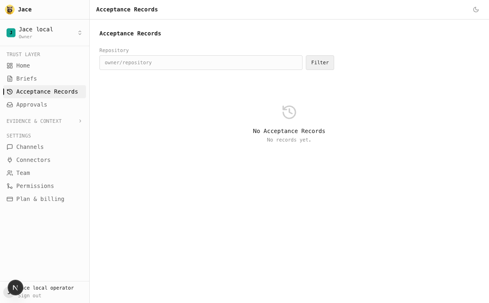

# Local separation verification — 2026-11-09

Jace is a public Apache-2.0 repository with preserved Git history. It runs without an AgentRail server/account and uses its own local PostgreSQL, ClickHouse, artifact storage, Console, coordinator and workers. Vercel is a later hosting target; no production cutover is claimed.

- `pnpm local:up` completed on macOS with Node 24, pnpm 9, Python and Docker. Both application and durable-workflow database migrations ran before the coordinator started. A second start preserved local data.
- Console owner sign-in required no GitHub OAuth. The local Acceptance Records page rendered independently, and signing into Jace did not overwrite the AgentRail session.
- The coordinator explicitly listened on 127.0.0.1. Review and Context Pack regeneration workers started; the latter receives only its dedicated credential.
- A real Eve client request used the local Ollama qwen3:4b model and returned `Jace is running locally.` The cold turn took several minutes and retried once. This proves local connectivity and durable execution, not model quality or full acceptance-task competence.
- Coordinator: 2,241 unit tests passed and production build passed. Trust MCP: 26 tests passed. Console production build passed before the local-login addition, and final type checking passed afterwards. Shared CLI compatibility focus: 49 passed, 2 skipped. Local login's real PostgreSQL exchange/expiry/concurrency tests passed in the shared implementation.
- A fresh-context review found and then cleared the local startup blockers in CLI resolution, occupied-port handling and shutdown.

External GitHub/chat integrations and independent browser criterion proof require their documented credentials/environments. Unavailable evidence must remain not_testable/not_proven. Existing production services, open trust PRs and historical deployment material were not migrated by source extraction.
